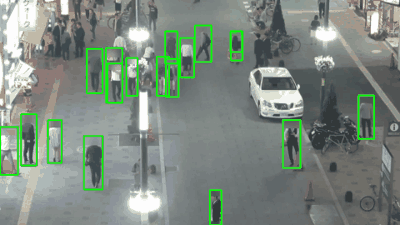
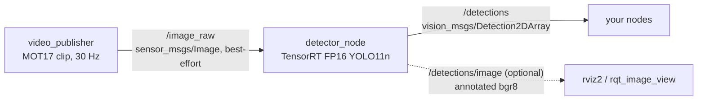
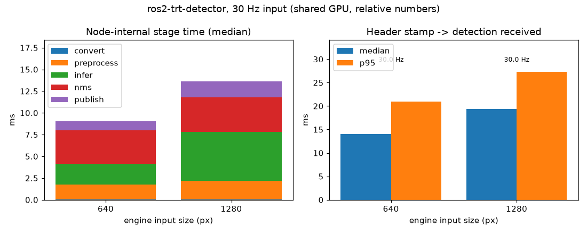

# ros2-trt-detector

A ROS 2 (Jazzy) node that runs a TensorRT FP16 YOLO11n detector on a camera image topic and publishes `vision_msgs/Detection2DArray`, plus an optional annotated image. The repo also has a test video publisher and a latency benchmark measured on the real ROS 2 message path.



(MOT17-04 pedestrian clip, low-res, head regions blurred. Boxes are drawn from the `/detections` messages.)

## Node graph



Inside `detector_node` (per frame): message buffer -> numpy view (no copy, honors `step`) -> host-to-device copy, GPU letterbox resize + BGR/RGB handling -> TensorRT -> top-k on GPU, NMS on CPU -> pack `Detection2D` with the input header (stamp and frame_id copied).

## Topics

| Topic | Type | Direction | Notes |
|---|---|---|---|
| `image_topic` (default `/image_raw`) | `sensor_msgs/Image` | in | `bgr8`, `rgb8` or `mono8`; best-effort, keep-last `qos_depth` |
| `/detections` | `vision_msgs/Detection2DArray` | out | header copied from the input; bbox = centre + size in source pixels; `results[0].hypothesis.class_id` = COCO name |
| `/detections/image` | `sensor_msgs/Image` | out | only if `publish_annotated_image:=true`, and only while someone subscribes |

## Parameters (`config/detector.yaml`)

| Parameter | Default | Meaning |
|---|---|---|
| `engine_path` | `engines/yolo11n_fp16_640.plan` | TensorRT plan (relative to the working directory). Input size comes from the engine |
| `image_topic` | `/image_raw` | input topic |
| `score_threshold` | `0.25` | confidence threshold |
| `nms_iou_threshold` | `0.7` | class-aware NMS IoU |
| `classes` | `["person"]` | COCO class names to keep; `[]` = all 80 |
| `max_detections` | `100` | cap per frame |
| `publish_annotated_image` | `false` | publish `/detections/image` |
| `qos_depth` | `1` | subscription queue depth; frames are dropped when inference is slower than the camera |
| `gpu_memory_fraction` | `0.3` | cap on PyTorch's allocator share of GPU memory |
| `timing_csv` | `""` | if set, per-frame stage times are written here on shutdown |

Launch arguments: `engine_path`, `image_topic`, `publish_annotated_image`, `video` (if set, also starts the test publisher on that file).

## Results

Setup: the GPU is a shared NVIDIA GB10 (aarch64 desktop-class GPU), not a Jetson. It was already about 82-85% utilised by other jobs when each run started (`gpu_util_before_pct` in `results/bench.json`), so absolute numbers are noisy and only meaningful relative to each other. The stack is TensorRT 10.16 and ROS 2 Jazzy with Fast DDS shared memory. The source is MOT17-04 (pedestrians, CC BY-NC-SA 3.0), resized to 1280x720 `bgr8` and published at 30 Hz. The model is YOLO11n FP16, person class, conf 0.25. Each point runs 60 s after an 8 s warm-up, once, with no repeats, so treat differences of a few ms as noise.

Latency is in ms, median / p95. "Stamp to receive" runs from the image header stamp (set by the publisher just before publishing) to the moment a separate consumer process receives the detections, so it includes DDS transfer of a 2.7 MB image and of the result. It does not include camera exposure or a real driver.

| Engine input | Detection rate | Stamp to receive | Convert | Preprocess | Infer | NMS | Publish | Node total | Node CPU (% of 1 core) | Publisher CPU |
|---|---|---|---|---|---|---|---|---|---|---|
| 640 | 30.0 Hz | **14.1 / 21.0** | 0.04 / 0.10 | 1.73 / 3.32 | 2.37 / 3.70 | 3.84 / 6.15 | 1.07 / 2.06 | 9.33 / 14.15 | 35 | 80 |
| 1280 | 30.0 Hz | **19.4 / 27.3** | 0.04 / 0.10 | 2.14 / 3.64 | 5.64 / 8.04 | 3.97 / 6.20 | 1.83 / 3.00 | 13.84 / 19.70 | 49 | 81 |

Both sizes kept up with the 30 Hz input (about 1800 frames each, no sustained drops). Stage times are measured inside the node with a GPU synchronize between stages. "NMS" includes the device-to-host copy, so it also absorbs any GPU wait not captured by "Infer". The publisher's CPU is high because it decodes and resizes video in Python; that is a test source, not part of the detector.

Raw data: `results/bench.json`, `results/bench.csv`, per-frame stage times `results/frames_640.csv`, `results/frames_1280.csv`.



## Reproduce

Requirements: ROS 2 Jazzy (`ros-jazzy-vision-msgs`), Python 3.12 with `torch` (CUDA), `torchvision`, `tensorrt` 10.x, `opencv-python`, `numpy`; `ultralytics` for the engine build; `psutil`, `matplotlib`, `pillow` for the tools.

```bash
# 1. build the engines (fixed input size, FP16); weights are downloaded by Ultralytics if missing
python3 tools/build_engine.py --imgsz 640
python3 tools/build_engine.py --imgsz 1280

# 2. build the package
source /opt/ros/jazzy/setup.bash
colcon build --symlink-install --parallel-workers 2
source install/setup.bash

# 3. run detector + video source (from the repo root, so engine_path resolves)
export FASTRTPS_DEFAULT_PROFILES_FILE=$PWD/config/fastdds_shm.xml   # see Limitations
ros2 launch trt_detector detector.launch.py video:=/path/to/clip.mp4 publish_annotated_image:=true
ros2 topic echo /detections --once

# 4. benchmark + plot + preview
python3 tools/benchmark.py --video /path/to/clip.mp4 --sizes 640 1280
python3 tools/plot.py
python3 tools/make_preview.py --video /path/to/clip.mp4

# tests (no ROS runtime needed)
PYTEST_DISABLE_PLUGIN_AUTOLOAD=1 python3 -m pytest -q
```

To use your own camera, point `image_topic` at it and drop the `video:=` argument.

## Deploying on a Jetson Orin

This is an approach, not measured.

I have not run this on a Jetson. This is the approach I would take:

1. Flash JetPack 6.x (Ubuntu 22.04, TensorRT 10 and CUDA included) and use ROS 2 Humble, or run the Jazzy container of your choice; the node uses only `rclpy`, `sensor_msgs` and `vision_msgs`.
2. Install a PyTorch build for JetPack (NVIDIA's Jetson wheels) and `torchvision`; the node uses torch only for GPU tensors, resize and NMS.
3. Build the engine on the Jetson itself (`tools/build_engine.py`); plans are not portable across GPUs or TensorRT versions. Fix the power mode (`nvpmodel`, `jetson_clocks`) before benchmarking.
4. Re-run `tools/benchmark.py` there. On a memory-constrained Orin, check whether the 640 or 1280 engine meets your rate, and consider an INT8 engine if accuracy allows.

## Limitations

- Single stream, batch 1, one engine per input size (fixed shape). Letterbox preprocessing, no rotation or camera-info handling.
- Detections only: no tracking, no 3D, no per-class tuning beyond a class list.
- Large images and DDS: with the default Fast DDS transports, 2.7 MB best-effort images were mostly dropped at 30 Hz on this machine (about 5-10 Hz received, from both the detector and `ros2 topic hz`). A shared-memory profile with a larger segment (`config/fastdds_shm.xml`) fixed it. With a real camera driver, prefer compressed images, a smaller resolution, or composable nodes with intra-process transport.
- The CPU NMS step runs on at most 300 candidate boxes; with very crowded scenes and a low threshold, tune `max_detections` and `score_threshold`.
- Numbers are from a shared GPU, a single run per point, and a synthetic source (video replay, publisher stamps frames at send time).
- Weights are Ultralytics YOLO11n (AGPL-3.0). Check licence terms before shipping a product.

## Layout

```
src/trt_detector/   ament_python package: detector_node, video_publisher, engine, packing, launch, config, tests
tools/              build_engine.py, benchmark.py, plot.py, make_preview.py
config/             fastdds_shm.xml
results/            bench.json, bench.csv, per-frame CSVs, bench.png
```

MIT licence (this repo). MOT17 clips are CC BY-NC-SA 3.0 and are not included.
